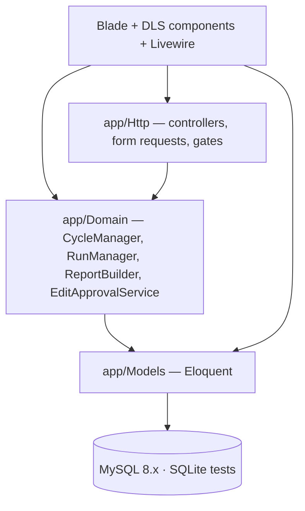
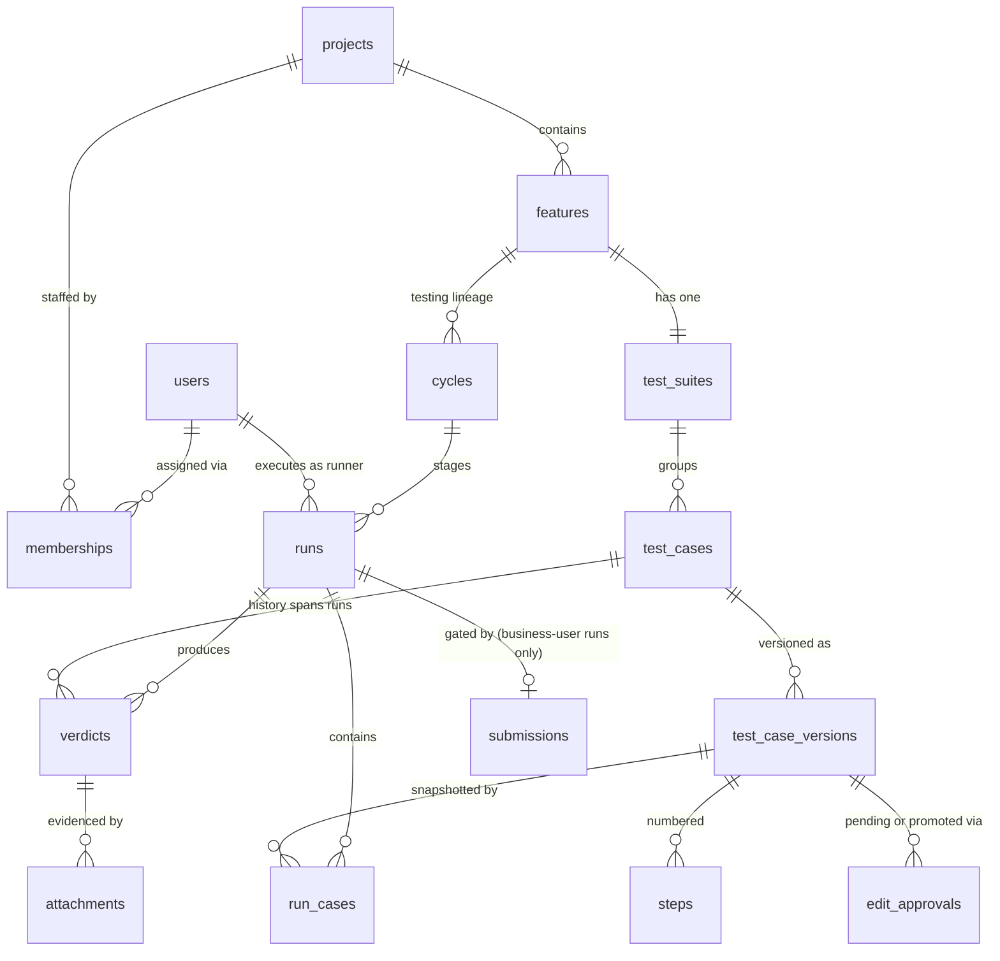

# Architecture Spine — iium_tester

## Design Paradigm

**Server-rendered MVC monolith with Livewire 3 islands.** One Laravel 13 deployable; every page is a Blade view, interactive surfaces (the tick screen, suite authoring, report views) are Livewire 3 components — PHP classes, no JavaScript framework. Domain state transitions live in plain PHP services under `app/Domain`, so the Run/Cycle lifecycle is owned by code the HTTP layer calls but never contains.

```text
Presentation  resources/views (Blade) + DLS components + Livewire components
HTTP          app/Http — controllers, form requests, middleware, gates
Domain        app/Domain — CycleManager, RunManager, ReportBuilder, EditApprovalService
Persistence   app/Models (Eloquent) + migrations
```

## Invariants & Rules

### AD-1 — One monolith, one rendering model, session auth [ADOPTED]

- **Binds:** all
- **Prevents:** drift into SPA/API-first splits, mixed rendering models, or JWT/session dual auth
- **Rule:** Single Laravel 13 deployable. UI is Blade + Livewire + Alpine + Tailwind only — no React, no Vue, no separate JSON API surface. Auth is Laravel session (httpOnly cookie) exclusively; role checks ride the session user. No JavaScript-framework frontend code enters the tree.

### AD-2 — Run/Cycle state transitions are owned by domain services

- **Binds:** FR-6, FR-7, FR-13, FR-14, FR-15; E3, E4, E5
- **Prevents:** each controller/Livewire component re-implementing lifecycle guards (stage order, one-runner-per-stage, abandoned-restart, done-is-terminal) inconsistently
- **Rule:** Every mutation of Run state, Cycle state, stage availability, re-run scope, or Done Declaration goes through `app/Domain` services; controllers and Livewire components may read Eloquent directly but never write Run/Cycle state themselves. **Single-writer split:** `RunManager` alone writes `runs.status` (lifecycle: Not Started → In Progress → Completed / Abandoned); `CycleManager` alone writes Cycle state, stage availability, and re-run scope — it grants `RunManager` permission to start a Run, it never writes run rows.

### AD-3 — An immutable version row *is* the snapshot (single versioning mechanism)

- **Binds:** FR-5, all Run execution; E2
- **Prevents:** two divergent mechanisms — an approval workflow that copies content vs a run-time snapshot — drifting apart
- **Rule:** Test Case content lives only in `test_case_versions` rows, immutable once written. `run_cases` is the snapshot pivot: its NOT NULL `test_case_version_id` is set when the Run is created and never updated, and the pivot carries **no result columns** (results live only in `verdicts` — AD-4). A mid-cycle edit creates a new version row with `approved_at = null` (pending); pending versions are **never executable**; Admin approval promotes, rejection leaves the row dead. Every Run — including re-runs — snapshots the currently-approved version per Test Case at Run start; in-flight Runs are unaffected by later approvals.

### AD-4 — Status History is insert-only, structurally

- **Binds:** FR-8, FR-9; E3
- **Prevents:** history rewriting and audit drift
- **Rule:** The `verdicts` table (actor, timestamp, status, comment, attachments, per run per test case) is append-only: no update/delete routes exist, model classes expose no mass-update, corrections are new entries. Append-only is guaranteed by structure, not convention. Verdicts are the **sole authoritative record of execution results**: a Test Case's current status within a Run is its latest verdict for (run, test case). `RunManager` writes verdicts; `ReportBuilder` and all views read them — results are never denormalized anywhere else.

### AD-5 — Permissions are named gates, applied at routes

- **Binds:** FR-1, FR-2, FR-3; E1
- **Prevents:** per-page ad-hoc role checks drifting from the permission matrix
- **Rule:** One Gate (or Policy) per capability, defined centrally, named after the matrix (e.g. `run-tests`, `submit-reports`, `mark-fixed`, `approve-edits`). Route middleware applies gates; Livewire components enforce the **same named gates** on mount and on every action (route middleware alone does not cover component endpoints); blade hides controls the role lacks (not merely disables). A failed check returns the explicit "not permitted for your role" message.

### AD-6 — Styling comes from IIUM DLS tokens only [ADOPTED]

- **Binds:** all UI; E1
- **Prevents:** hardcoded colors/fonts drifting from the IIUM Digital DLS and a light/dark theme split
- **Rule:** Brand tokens (`--iium-turquoise`, `--iium-gold`, the `deep`/`surface`/`raised` surface trio per theme, Roboto Slab / Inter / Barlow Condensed, radii, the ease-spring motion curve) are defined once as Tailwind theme extensions from the DLS and consumed via shared Blade components (the DLS component vocabulary: card, button, form control, brand label, theme toggle). No raw hex or font names inside views/Livewire templates. Light is default; dark rides the `[data-theme="dark"]` attribute with persistence via `localStorage` key `iium-theme`, exactly as the DLS toggle does. Semantic status tokens extend the DLS set, defined once as theme tokens: Pass → turquoise, Blocked → gold, Fail → danger red (the DLS defines no failure color — this addition is ours), Skipped → muted gray.

### AD-7 — One report rendering path: Blade views → dompdf

- **Binds:** FR-9, FR-10, FR-11, FR-12; E3, E4
- **Prevents:** screen and PDF report implementations diverging
- **Rule:** Reports render from Blade view sources through `barryvdh/laravel-dompdf`; the on-screen report and the PDF export share the same view source, screenshots included. No second rendering pipeline, no client-side print dependency.

### AD-8 — Portable persistence

- **Binds:** all persistence; E1 [ASSUMPTION: MySQL 8.x primary — typical university PHP hosting + MAMP local]
- **Prevents:** vendor-specific schema locking out local/test environments
- **Rule:** Migrations use portable column types; MySQL 8.x is the primary target, SQLite remains viable for tests and local runs.

### AD-9 — Attachments: local disk, validated, signed URLs

- **Binds:** FR-6, FR-12; E3 [ASSUMPTION: local disk adequate for v1 scale]
- **Prevents:** screenshots leaking via public paths or ad-hoc storage schemes
- **Rule:** Screenshot uploads go to a dedicated non-public storage disk, validated as PNG/JPG with a config-set size cap, sized to the PRD scale assumption (~10–50 users, dozens of concurrent active Runs). Attachments are served only through **expiring** signed URLs generated per authorized request; report PDFs — including private-run reports — stream through gate-checked controller responses, never a public or indefinitely-valid URL. No cloud storage in v1.

### Dependency direction



Rule encoded by the graph: `app/Domain` imports Models only — never HTTP, Livewire, or view classes. Writes to Run/Cycle/Verdict flow: UI → Domain → Model (AD-2, AD-4).

## Consistency Conventions

| Concern | Convention |
| --- | --- |
| Naming | Eloquent models singular, matching the PRD glossary: `Project`, `Feature`, `TestSuite`, `TestCase`, `TestCaseVersion`, `Step`, `Cycle`, `Run`, `Verdict`, `Submission`, `Attachment`, `EditApproval`. Routes kebab-case plural resources (`/runs/{run}`). |
| Data & formats | bigint surrogate ids; string-backed PHP enums for every state (`RunStatus`, `CycleStatus`, `VerdictStatus`, `RunType`) with snake_case values as the stored form (`in_progress`, `failed_only`, `pass`); timestamps via Eloquent defaults (UTC). |
| State & cross-cutting | Validation via FormRequests; authorization via named gates (AD-5); flash + in-app notifications for events (Submission, approval requests); no background queue in v1 — PDF renders synchronously. |

## Stack

| Name | Version |
| --- | --- |
| PHP | ≥ 8.3 |
| Laravel | 13.x |
| Livewire | 4.x (ships in the Laravel 13 starter kit) |
| Tailwind CSS | 4.x (per current starter kit; DLS tokens as theme extensions) |
| barryvdh/laravel-dompdf | 3.x |
| MySQL (MAMP local) | 8.x |
| Alpine.js | 3.x (bundled with Livewire — no separate install) |

**Environments:** local dev = MAMP on macOS (Apache + MySQL; PHP 8.3.28 / 8.4.15 / 8.5.0 present — select ≥ 8.3). Automated tests = in-process SQLite (AD-8). Production target = open — see Deferred.

## Structural Seed



- `runs` carries `type` (staged pipeline vs re-run vs private) and runner; private runs are visible to their runner alone.
- `run_cases` is the snapshot pivot: (run, test case, exact test_case_version) — AD-3's mechanism.
- `verdicts` is the Status History — append-only (AD-4).

```text
{project-root}/
  app/
    Domain/          # CycleManager, RunManager, ReportBuilder, EditApprovalService — state machines
    Http/            # controllers, form requests, middleware, gates registration
    Livewire/        # tick screen, suite authoring, report browsing
    Models/          # Eloquent, per glossary naming
  resources/
    views/           # layouts · components (DLS) · reports (shared screen+PDF source)
  database/
    migrations/      # portable (AD-8)
  routes/web.php
```

## Capability → Architecture Map

| Capability / Area | Lives in | Governed by |
| --- | --- | --- |
| FR-1–3 Projects, users, roles | `app/Http` + gates | AD-1, AD-5 |
| FR-4 Authoring with numbered Steps | `app/Livewire` authoring + `TestCaseVersion` | AD-3 |
| FR-5 Edit approval | `EditApprovalService` + `edit_approvals` | AD-2, AD-3 |
| FR-6–7 Tick screen, staged pipeline | Livewire tick component + `RunManager`/`CycleManager` | AD-1, AD-2 |
| FR-8 Status History | `verdicts` + attachments | AD-4, AD-9 |
| FR-9–12 Reports, submission, failures-first, PDF | `ReportBuilder` + Blade report views + dompdf | AD-7 |
| FR-13–14 Re-run, Done Declaration | `CycleManager` | AD-2 |
| FR-15 Private runs | `RunManager` (`type=private`, runner-only visibility) | AD-2, AD-5 |
| NFR styling / responsive / themes | Tailwind theme extensions + DLS Blade components | AD-6 |

## Deferred

- **Production hosting target** — MAMP covers local dev; university shared hosting vs VPS vs container decides ops posture. Decide before first deploy.
- **Email notifications** — in-app only in v1 (PRD §7.2); revisit if Developers miss Submissions.
- **Async PDF rendering** — synchronous dompdf in v1; queue only if report size/latency demands it.
- **Cloud storage for screenshots** — local disk in v1 (AD-9); swap disk driver if scale requires.
- **FR-16 Reproduced status, disagreement flag, admin dashboard, multi-runner stages** — out of MVP per PRD; would extend `verdicts` states and gates, no structural change.
